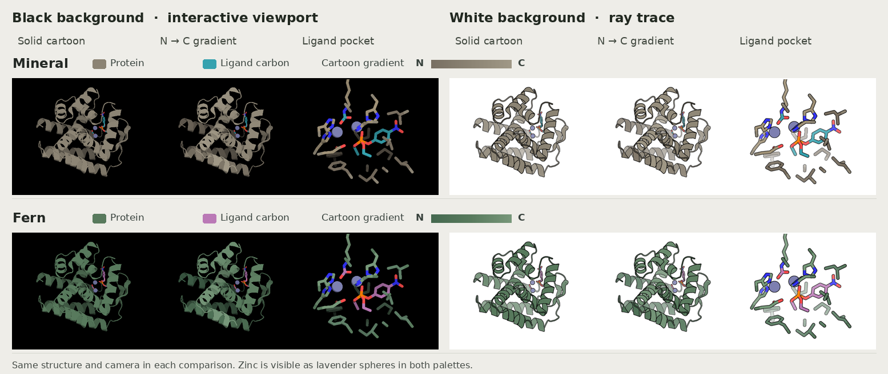

# PyMOL startup for protein structures

Open a structure with `pymol`. Use `pymolrfd4` to inspect coordinate and sequence annotations in RFdiffusion4-Proteina CIFs. Both commands accept the usual PyMOL flags and multiple files.



**Mineral** opens with a warm taupe protein and lagoon-colored ligand carbons. The original matte cartoon lighting and black ray outlines apply to every theme. Hydrogen, nitrogen, oxygen, phosphorus, sulfur, and metals use PyMOL’s element colors by default. **Fern** pairs a muted green protein with orchid ligand carbons. Both examples above use the bundled crystal design.

## Install

Keep the checkout together. From its root, link the startup file and launcher.

```sh
mkdir -p ~/.local/bin
ln -s "$PWD/.pymolrc" ~/.pymolrc
ln -s "$PWD/bin/pymolrfd4" ~/.local/bin/pymolrfd4
```

These commands leave an existing destination intact. Save any existing startup file outside PyMOL’s `.pymolrc*` search pattern before installing. Add `~/.local/bin` to your shell’s `PATH` if needed. The links follow edits in the checkout. PyMOL searches the launch directory before the home directory.

A copied startup file also works with a checkout at `~/pymolrc`, or with `PYMOLRC_ROOT` set to the checkout path. Ordinary viewing needs PyMOL. The annotation reader uses NumPy and Biopython in PyMOL’s Python environment. Complex input schemas can use the native RFD4 environment. [RFD4 setup and usage](RFD4_QUICKSTART.md)

## Open and compare

```sh
pymol prediction.cif design.cif
pymolrfd4 prediction.cif annotated.cif -d 'set grid_mode, 1'
```

The second command places the two structures side by side. The prediction keeps its molecular palette. The annotated structure shows absolute coordinate targets in ochre with gold beads, internal groups in lilac, and reference backbone in blue. Sticks retain chemical element colors. Inside an ordinary session, `rfd4_load annotated.cif, motif` opens one annotated copy.

For a large batch, put one structure path per line in `models.txt` and run `pymolrfd4 -d 'browse_list models.txt'`. All structures are loaded, the first is shown, and Page Up and Page Down switch between them. Passing the paths directly to `pymolrfd4` displays them together.

| In PyMOL | Action |
|---|---|
| `theme next`, `theme prev` | Preview the next or previous palette on open structures |
| `theme mineral` or `theme fern` | Choose a molecular palette |
| `theme mineral, gradient=on` | Shade each chain’s cartoon from N to C. Use `gradient=off` for the solid cartoon |
| `ligand_colors by_type` or `ligand_colors uniform` | Distinguish ligand components or give them the same carbon color |
| `theme classic, gradient=off` | Return to the original green cartoons and amethyst ligands |
| `theme foliage` | Use the same greens and amethyst with the original soft element colors |
| `rfd4_style , coordinates, markers=all` | Show every coordinate-conditioned atom as a small sphere |
| `rfd4_style , sequence` | Inspect fixed and free residue identities |
| `rfd4_style , legacy` | Use the original cyan/orange atom view and reference lines |
| `rfd4_autoload on` | Inspect annotations on subsequent files in this session |
| `pymolrc_help` | List all command groups |

## Commands and examples

- Browse structure lists with `browse_list` and the page keys. Inspect sequences with `seq`, metal ions with `show_metals`, and PDB matcher residues with `show_catres`. [Command reference](docs/COMMANDS.md)
- Choose molecular and brand colors or apply an RFdiffusion backbone gradient. [Color guide](docs/COLORS.md)
- Inspect atom masks, centroid markers, and reader timings. [RFD4 inspection guide](RFD4_QUICKSTART.md) · [Rendered constraint legend](docs/viewer-guide.png)
- Make trajectory movies and figures with the standalone RFD3 kit. [RFD3 quickstart](RFD3_QUICKSTART.md) · [Figure examples](docs/RFD3_FIGURES.md)
- Superpose refined structures and view electron density with the crystallography kit. [Crystal commands and bundled example](crystallography/README.md)

The startup file loads rendering defaults, palettes, browsing hooks, and display commands from [config/](config/). The RFD3 movie and crystallography kits also work independently. Sample structures are in [example_pdbs/](example_pdbs/) and [crystallography/example/](crystallography/example/).
