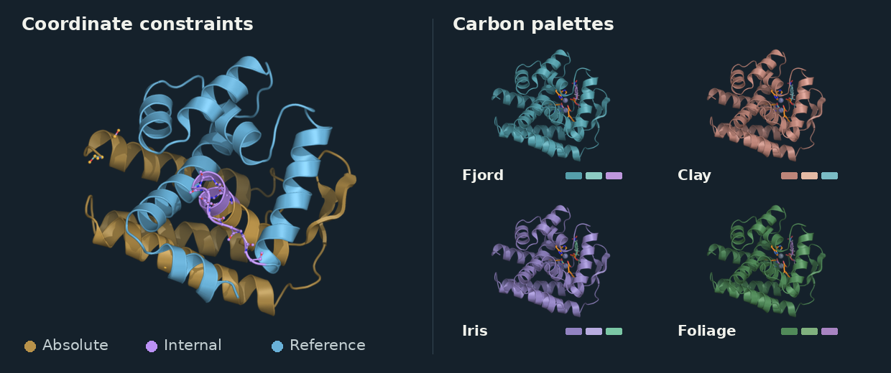

# Molecular palettes

Type `theme next` or `theme prev` in PyMOL to cycle through the four looks. `theme list` marks the active one. Selecting a palette changes the open structures and sets the colors for subsequent loads in the session. The camera stays in place.

| Theme | Sidechain carbon | Backbone carbon | Ligand carbon |
|---|---|---|---|
| `fjord` (default) | Mint `#8CCBC3` | Teal `#559EAA` | Lilac `#BE97DD` |
| `clay` | Peach `#E4BAA4` | Terracotta `#BD8579` | Aqua `#7BBCC5` |
| `iris` | Lavender `#B8ACE0` | Violet `#9283C2` | Jade `#7BC7A5` |
| `foliage` | Sage `sc05` | Forest `bb05` | Amethyst `lig_amethyst3` |

Fjord, Clay, and Iris use PyMOL’s stock element colors, including blue nitrogen, red oxygen, yellow sulfur, and bright orange phosphorus (`#FF8000`). Foliage restores the original soft element palette. The older custom RGB that previously replaced PyMOL’s built-in `nitrogen` is available as `legacy_nitrogen`.

The named `sc01`–`sc10`, `bb01`–`bb10`, amethyst, Seaborn, and RFdiffusion palettes are available to existing scripts. `color_palette` applies the original per-object foliage cycle, alignment, and ligand shell. The three `color_bb_rfdiffusion*` commands apply residue gradients. [Gradient examples](COMMANDS.md) · [Original foliage render](foliage-original.png)

## Brand colors

Use these names with PyMOL’s `color` command, for example `color ipd_logo_blue, chain A and elem C`.

**[NVIDIA](https://www.nvidia.com/content/dam/en-zz/Solutions/about-us/documents/NVIDIA-Trademark-and-Logo-Usage-Guidelines.pdf)**

| Color name | HEX |
|---|---|
| `nvidia_green` | `#76B900` |
| `nvidia_black` | `#000000` |
| `nvidia_dark_gray` | `#1E1E1E` |
| `nvidia_white` | `#FFFFFF` |

Black is also specified in the [NVIDIA logo guidelines](https://www.nvidia.com/content/dam/en-zz/Solutions/about-us/NVIDIA-Brand-Guidelines-for-NVIDIA-Partner-Network-v03-3-5-19.pdf).

**[IPD](https://www.ipd.uw.edu/wp-content/uploads/2025/03/IPD-logo-UW-color-2025.png)**

These values are sampled from solid fills in IPD’s current official logo,
not a published color specification. Existing `ipd_blue` (`#4196B5`) and
`ipd_purple` (`#B41F85`) remain available with their original values.

| Color name | HEX |
|---|---|
| `ipd_logo_blue` | `#4D97B7` |
| `ipd_logo_magenta` | `#B11186` |
| `ipd_uw_purple` | `#4B2E83` |

**[UW](https://www.washington.edu/brand/brand-elements/colors/)**

Uses the published digital HEX values; some RGB labels on UW’s page differ.
`uw_purple` / `uw_gold` are aliases for Husky Purple / Husky Gold.

| Color name | HEX |
|---|---|
| `uw_purple` | `#32006E` |
| `uw_husky_purple` | `#32006E` |
| `uw_spirit_purple` | `#4B2E83` |
| `uw_gold` | `#B7A57A` |
| `uw_husky_gold` | `#B7A57A` |
| `uw_web_gold` | `#E8E3D3` |
| `uw_heritage_gold` | `#85754D` |
| `uw_spirit_gold` | `#FFC700` |
| `uw_accent_green` | `#AADB1E` |
| `uw_accent_teal` | `#2AD2C9` |
| `uw_accent_pink` | `#E93CAC` |
| `uw_accent_lavender` | `#C5B4E3` |

**[Michigan](https://brand.umich.edu/design-resources/colors/)**

| Color name | HEX |
|---|---|
| `umich_maize` | `#FFCB05` |
| `umich_blue` | `#00274C` |
| `umich_tappan_red` | `#9A3324` |
| `umich_ross_orange` | `#D86018` |
| `umich_rackham_green` | `#75988D` |
| `umich_wave_field_green` | `#A5A508` |
| `umich_taubman_teal` | `#00B2A9` |
| `umich_arboretum_blue` | `#2F65A7` |
| `umich_a2_amethyst` | `#702082` |
| `umich_matthaei_violet` | `#575294` |
| `umich_peony_pink` | `#E01F7C` |
| `umich_umma_tan` | `#CFC096` |
| `umich_burton_tower_beige` | `#9B9A6D` |
| `umich_angell_hall_ash` | `#989C97` |
| `umich_law_quad_stone` | `#655A52` |
| `umich_puma_black` | `#131516` |

Sources checked September 10, 2026.
